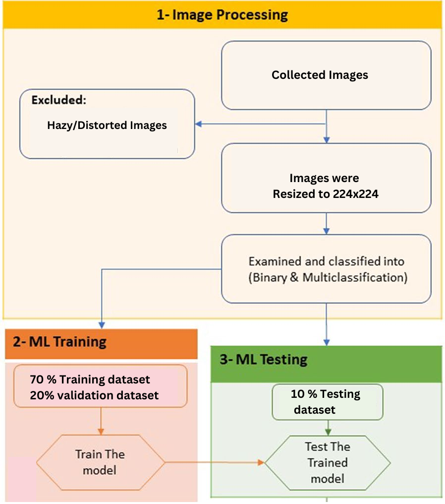
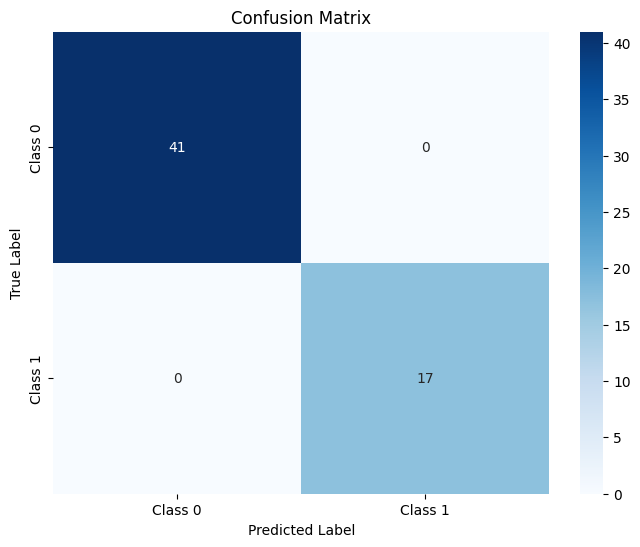
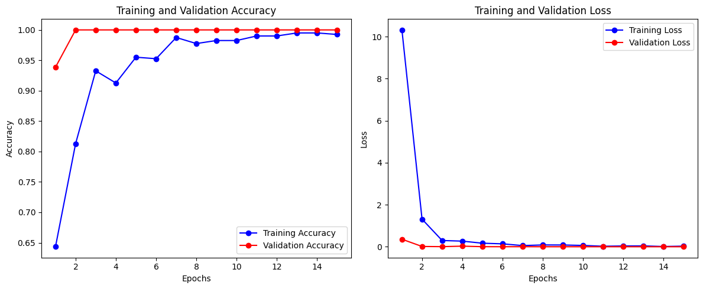
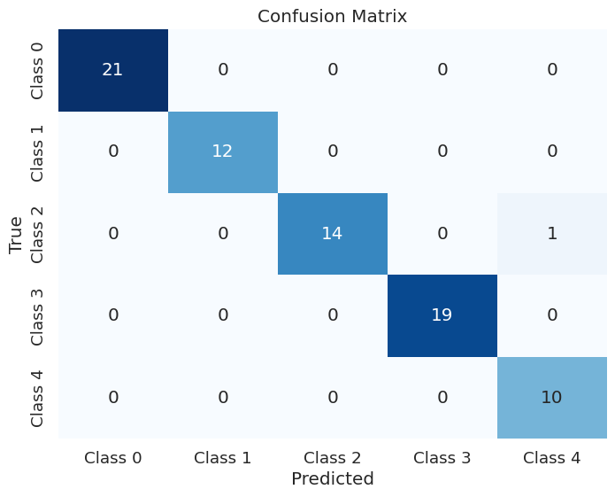
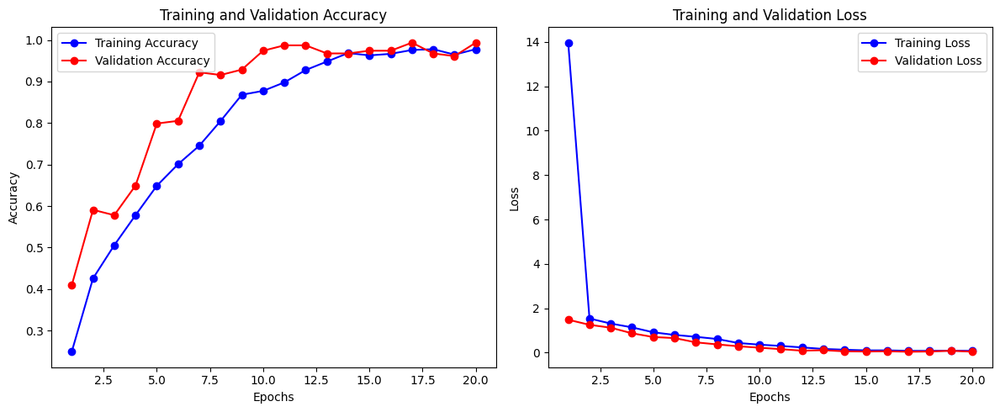

# Conjunctivitis Detection and Subtype Classification with a Fine-Tuned VGG-16

**Paper and code.** Esha Sabir¹, Umber Noureen¹, Muhammad Azhar²
¹ University of Sahiwal, Pakistan · ² Department of Data Science and Digital Innovation, Hong Kong Shue Yan University

This repository holds the draft paper ([`paper/esha_conjunctivitis_ieee.pdf`](paper/esha_conjunctivitis_ieee.pdf), not yet peer reviewed), the two training notebooks and every figure the paper reports. The work began as Esha Sabir's final-year project at the University of Sahiwal, supervised by Umber Noureen. Research code only; not a medical device.

## Abstract

Two Google Colab notebooks fine-tune an ImageNet-pretrained VGG-16, truncated after `block4_conv3`, on external eye photographs.

- `binary.ipynb` separates conjunctivitis from healthy eyes (573 images).
- `Multi_classification.ipynb` separates five classes: allergic, bacterial and viral conjunctivitis, uveitis and healthy eyes (769 images).

On one random held-out split, the saved notebook outputs show:

- binary: all 58 test images correct
- five-class: 76 of 77 test images correct (accuracy 0.987, weighted F1 0.987, MCC 0.984)

The test sets are small, the split is not stratified or grouped by patient or source, and there was no external validation. These are early, single-run results, not evidence of clinical performance.

## Problem and clinical motivation

Conjunctivitis ("pink eye") is common and contagious, and it is usually diagnosed by looking at the eye. Its bacterial, viral and allergic forms are treated differently but can look alike, and laboratory tests are rarely used in primary care. In 2023, a large viral conjunctivitis outbreak in Pakistan closed schools in Punjab.

A screening aid that works from an ordinary eye photograph could help with triage, but only once it has been validated on clinical data. This project is a first step: it tests whether a pretrained CNN can separate these classes on publicly collected images.

## Method



*Figure 1. Project pipeline.*

### Dataset

The images are **not included** in this repository. The notebooks read them from Google Drive (`/content/drive/My Drive/binaryDataset` and `/content/drive/My Drive/multidataset`).

| Task | Classes (folder names) | Images | Source of the counts |
|---|---|---|---|
| Binary | `conjunctivitis`, `healthy eye` | 573 total | `binary.ipynb`, cell 13 output |
| Five-class | `allergic conjunctivitis` 130, `Uveitis` 150, `bacterial conjuntivities` 150, `healthy eye` 209, `viral conjuntivities` 130 | 769 total | `Multi_classification.ipynb`, cell 6 output |

The saved binary notebook does not print per-class counts. Its test split contains 41 conjunctivitis images and 17 healthy images. Hazy or distorted images were excluded before training.

The images were collected from public online datasets. The paper cites S. Ali, *Conjunctivitis dataset*, and Kondwani, *Eye disease dataset* (both accessed January 2025). They are not redistributed here: to reproduce this work, get them from the original sources under those sources' terms.

### Preprocessing and split

- Every image is resized to 224×224×3.
- Pixel values go into the network as raw 0–255 values. The training code does no rescaling and no data augmentation.
- Labels are integer-encoded with scikit-learn `LabelEncoder` (alphabetical order), then one-hot encoded.
- The split uses `train_test_split` with `random_state=42`. It splits 70/30 first, then splits the 30% part 2:1. The result is roughly 70% training, 20% validation and 10% test. The split is random and not stratified.

| Task | Train | Validation | Test |
|---|---|---|---|
| Binary | 401 | 114 | 58 |
| Five-class | 538 | 154 | 77 |

### Architecture

VGG-16 with ImageNet weights (`include_top=False`), cut after `block4_conv3` (Keras layer index 13, output 28×28×512). All layers stay trainable.

| | Binary | Five-class |
|---|---|---|
| Head | GlobalAveragePooling2D → Dense 512 (ReLU) → Dropout 0.7 → Dense 256 (ReLU) → Dropout 0.5 → Dense 2 (softmax) | GlobalAveragePooling2D → Dense 256 (ReLU) → Dropout 0.5 → Dense 5 (softmax) |
| Parameters (all trainable) | 8,029,762 | 7,767,877 |

### Training setup

- **Optimiser and loss:** Adam with learning rate 1e-4; categorical cross-entropy.
- **Learning-rate schedule:** constant for epochs 0–9, then `1e-4 · exp(-0.1 · (epoch − 10))`.
- **Early stopping:** on validation loss, patience 3, best weights restored.
- **Epochs:** up to 20. The binary run stopped after 15 epochs; the five-class run completed all 20.
- **Class weights:** inverse class frequency. Binary uses `n / (2·count)`; five-class uses scikit-learn `compute_class_weight('balanced')`.
- **Environment:** Google Colab with a GPU. The five-class notebook prints TensorFlow 2.18.0, Keras 3.8.0, NumPy 2.0.2 and OpenCV 4.11.0. The binary notebook's log format shows an older Keras 2 / TensorFlow 2.x runtime; its exact versions were not recorded.

## Results

All numbers are copied from the saved outputs of the notebooks in this repository. Each comes from one training run, evaluated on the held-out test split. Precision, recall and F1 are weighted averages. The paper reports the same numbers.

| Task | Test images | Accuracy | Precision | Recall | F1 | MCC | Cohen's κ |
|---|---|---|---|---|---|---|---|
| Binary | 58 | 1.000 | 1.000 | 1.000 | 1.000 | 1.000 | 1.000 |
| Five-class | 77 | 0.987 | 0.988 | 0.987 | 0.987 | 0.984 | 0.983 |

### Binary: conjunctivitis vs healthy eye



*Figure 2. Binary test confusion matrix (class 0 = conjunctivitis, class 1 = healthy eye).*



*Figure 3. Binary training curves. Early stopping ended training after 15 epochs.*

### Five-class



*Figure 4. Five-class test confusion matrix. Class order comes from `LabelEncoder`, which sorts the capitalised `Uveitis` first: 0 = uveitis, 1 = allergic, 2 = bacterial, 3 = healthy, 4 = viral. The single error is one bacterial conjunctivitis image predicted as viral.*



*Figure 5. Five-class training curves (20 epochs).*

### Earlier thesis run

An earlier five-class run from the final-year thesis (figures uploaded in March 2024) classified 73 of 77 test images correctly. Computed from its confusion matrix, that gives accuracy 0.948, weighted precision 0.958, recall 0.948 and F1 0.947. All four errors are class-4 images predicted as class 2.

Its figures are kept in [`figures/thesis_run/`](figures/thesis_run/). The two runs differ, so neither number should be quoted alone as "the" accuracy.

With 58 and 77 test images, one error moves accuracy by 1.3–1.7 percentage points. Read these results as "the model fits this collection well", not as an estimate of real-world accuracy.

## How to reproduce

The notebooks were written for Google Colab with Google Drive mounted.

1. Open a notebook in Colab (use the badge at the top of the notebook) and select a GPU runtime.
2. Download the source datasets and arrange them in Google Drive like this:

   ```
   My Drive/
   ├── binaryDataset/
   │   ├── conjunctivitis/
   │   └── healthy eye/
   └── multidataset/
       ├── allergic conjunctivitis/
       ├── bacterial conjuntivities/
       ├── healthy eye/
       ├── Uveitis/
       └── viral conjuntivities/
   ```

   The folder names become the class labels, so they must match exactly, including the existing spellings.
3. Create `My Drive/EyeSpy_Model/`; the notebooks save the trained models there.
4. Run the cells from top to bottom. Skip cell 2 of `Multi_classification.ipynb`, which installs packages from a `requirement.txt` on the author's Drive. Install from this repository instead:

   ```bash
   pip install -r requirements.txt
   ```

To run locally instead of in Colab, install the requirements, remove the `google.colab` cells and set `dataset_path` to your local folder. Exact numbers will vary between runs: no global seed is set, and GPU training is not fully deterministic.

## Repository structure

```
.
├── paper/
│   └── esha_conjunctivitis_ieee.pdf        # draft manuscript (not peer reviewed)
├── binary.ipynb                            # conjunctivitis vs healthy: data loading, training, evaluation
├── Multi_classification.ipynb              # five-class model, evaluation and a Gradio demo
├── figures/
│   ├── methodology.png                     # Figure 1
│   ├── binary_confusion_matrix.png         # Figure 2 (from binary.ipynb)
│   ├── binary_training_curves.png          # Figure 3 (from binary.ipynb)
│   ├── multiclass_confusion_matrix.png     # Figure 4 (from Multi_classification.ipynb)
│   ├── multiclass_training_curves.png      # Figure 5 (from Multi_classification.ipynb)
│   └── thesis_run/                         # earlier five-class run from the thesis
├── requirements.txt
├── CITATION.cff
└── LICENSE                                 # MIT (code; datasets keep their own licences)
```

## Limitations

- **Small, single-split evaluation.** There is one random split, with 58 and 77 test images. There is no cross-validation and there are no confidence intervals.
- **Possible leakage and shortcut learning.** The images come from several public collections. The split is not grouped by patient or by source, and near-duplicate images were not removed. The model may therefore partly learn which collection an image came from (lighting, framing, resolution, greyscale healthy images) instead of the disease. Perfect test scores on a small set are a reason for caution.
- **No external or clinical validation.** The labels come from the public datasets and were not confirmed by an ophthalmologist for this study.
- **Preprocessing mismatch in the demo.** Training uses raw 0–255 pixels, but the Gradio function in `Multi_classification.ipynb` divides by 255. Its `class_names` list is also not in the `LabelEncoder` order, so the demo's predictions are not reliable as written. The notebook's last cells are an unfinished investigation of this issue.
- **Notebook hygiene.**
  - Cells 5–7 of `binary.ipynb` show outputs from an earlier version.
  - Cell 11 refers to a variable that is not defined in that notebook.
  - Cell 10 overwrites the images in the Drive folder with resized copies.
- **No severity grading or treatment advice.** Neither is implemented; both are future work.

## Ethical note

This is research and educational code. It is **not** a medical device and must not be used to diagnose, triage or treat anyone. Eye photographs are health data: anyone extending this work with new images needs consent and the relevant ethics approval.

## Citation

Paper (draft, not yet peer reviewed):

```bibtex
@unpublished{sabir_conjunctivitis_vgg16,
  author = {Sabir, Esha and Noureen, Umber and Azhar, Muhammad},
  title  = {A Fine-Tuned {VGG-16} {CNN} Approach for Binary and Multiclass Detection and Classification of Conjunctivitis},
  note   = {Draft manuscript},
  url    = {https://github.com/EshaRana17/Conjunctivitis}
}
```

Code: see [`CITATION.cff`](CITATION.cff).

## Licence

Code: MIT, see [LICENSE](LICENSE). The datasets are not included and remain under their original licences.

## Contact

Esha Sabir · GitHub [@EshaRana17](https://github.com/EshaRana17) · [LinkedIn](https://www.linkedin.com/in/esha-sabir-3b269a220/)
